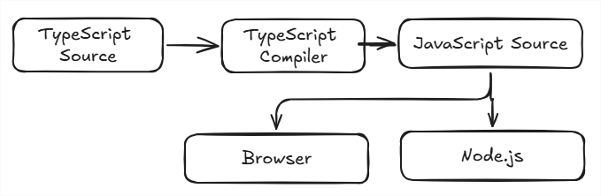

# TypeScript (Zero to Hero)

Runs at compilation time

## Setup

1. install node js
2. install typescript `npm i typescript -D`
3. check the version by `npx tsc --version`
4. `npx tsc index.ts` to compile the file
5. create tsconfig.json by `npx tsc --init` to compile multiple ts files
6. update tsconfig.json, uncomment rootDir and outDir
7. add dev in package.json ` "dev": "tsc --watch"`

## Foundation

## Type Modeling

## Advance Type System

## Real-World TypeScript

## Production & Architecture
